# Architecture Guide

This repository contains two main applications: a precious-metals price
dashboard at the repository root and stock-news tools under
[`stock_news_agent/`](./stock_news_agent/). The stock-news directory includes
both a MySQL-backed web/API application and a smaller asynchronous CLI pipeline.

## System overview

```mermaid
flowchart TD
    subgraph Metals["Precious-metals dashboard (repository root)"]
        Dashboard["precious_metals_dashboard.py"]
        Comex["get_gold_silver_comexlive.py"]
        Mcx["get_gold_silver_moneycontrol.py"]
        Fx["get_usdinr_moneycontrol.py"]
        Converters["gold_price_converter.py<br/>silver_price_converter.py"]
        Dashboard --> Comex
        Dashboard --> Mcx
        Dashboard --> Fx
        Dashboard --> Converters
    end

    subgraph StockApp["Stock-news web/API and database application"]
        App["stock_news_agent/app.py"]
        Service["stock_news_agent/stock_service.py"]
        DB["stock_news_agent/database.py<br/>MySQL: nifty_stocks"]
        Google["Google News RSS"]
        Yahoo["Yahoo Finance RSS"]
        Sentiment["NLTK VADER sentiment"]
        App --> Google
        App --> Yahoo
        App --> Sentiment
        App --> Service
        Service --> DB
    end

    subgraph AsyncCLI["Separate asynchronous news CLI"]
        CLI["stock_news_agent/cli.py"]
        RSS["providers/rss_provider.py"]
        YahooProvider["providers/yahoo_provider.py"]
        Model["models.py: NewsItem, Source"]
        Aggregator["aggregator.py"]
        CLI --> RSS
        CLI --> YahooProvider
        RSS --> Model
        YahooProvider --> Model
        CLI --> Aggregator
    end

    subgraph Bond["Bond-yield news job"]
        BondJob["stock_news_agent/us_bond_yield_news_agent.py"]
        BondJSON["stock_news_agent/bond_yield_news.json"]
        BondJob --> BondJSON
    end
```

These are related tools in one repository, not a single process or shared
runtime pipeline. In particular, the asynchronous CLI has its own provider and
aggregation modules; it does not call the MySQL-backed `app.py` news flow.

## Precious-metals dashboard

### Entry point and flow

Run `python precious_metals_dashboard.py` from the repository root.
`precious_metals_dashboard.py` coordinates the data sources, converters, and
Rich terminal UI:

1. Fetch USD/INR through `get_usdinr_moneycontrol.py`.
2. Fetch COMEX gold and silver through `get_gold_silver_comexlive.py`.
3. Fetch the MCX gold contract and Moneycontrol silver through
   `get_gold_silver_moneycontrol.py`.
4. Convert COMEX values to INR per 10 grams (gold) and per kilogram (silver),
   apply the configured duty/GST calculations, and render quote panels,
   comparison tables, and summary tables.

The MCX gold panel labels the quote provider. It tries Moneycontrol first and
falls back to the Economic Times MCX gold page if Moneycontrol is blocked or
cannot be parsed. The fallback is an MCX contract quote, not a COMEX-derived
estimate. Moneycontrol silver currently has no alternate provider.

### Price-source modules

| Module | Responsibility |
| --- | --- |
| `get_gold_silver_comexlive.py` | Fetches COMEX gold/silver HTML and extracts last, change, close, high, low, and trade-time fields. |
| `get_gold_silver_moneycontrol.py` | Fetches Moneycontrol MCX gold and silver. Gold can fall back to Economic Times; quote results use `PreciousMetalQuote`. |
| `get_usdinr_moneycontrol.py` | Fetches and parses USD/INR from Moneycontrol; uses a dated exchangerate-api.com reference rate if Moneycontrol is unavailable. |
| `gold_price_converter.py` | Converts COMEX USD/troy-ounce gold to INR/10g and applies gold import duty and GST. |
| `silver_price_converter.py` | Converts COMEX USD/troy-ounce silver to INR/kg and applies silver duty and GST. |

The COMEX conversion and the directly quoted MCX price are separate data paths.
Do not treat them as equivalent: one is an international price converted with
an FX rate, while the other is a specific Indian futures contract.

## Stock-news applications

### MySQL-backed FastAPI application

`stock_news_agent/app.py` is the main feature-rich application. It contains
the Google News and Yahoo Finance RSS fetchers, article normalization,
deduplication, VADER sentiment scoring, and FastAPI routes. It also exposes a
legacy CLI when run directly as `python stock_news_agent/app.py <command>`.

The news request flow is:

1. Accept ticker symbols and a date window from the web UI, `/news` endpoint,
   or the CLI.
2. For the requested tickers, fetch Google News RSS and Yahoo Finance RSS.
3. Normalize article fields and remove duplicates using link or title.
4. Score title/summary text with NLTK VADER, add timestamps and a short preview,
   then sort newest-first.
5. Return JSON or render the web template.

The `/news` endpoint and the `news` CLI command validate symbols against the
Nifty stocks database. The web page route also calls the news pipeline, while
the other `/stocks/...` endpoints provide stock lookup, search, sector,
statistics, and symbol validation.

`stock_news_agent/database.py` creates a SQLAlchemy connection to MySQL and
defines the `nifty_stocks` table. Connection settings are read from
`DB_HOST`, `DB_PORT`, `DB_USER`, `DB_PASSWORD`, and `DB_NAME`. The
`stock_service.py` module wraps the database operations for the API and CLI.
`populate_nifty_db.py` and related setup/import scripts support loading stock
records.

The FastAPI application is exposed as `stock_news_agent.app:api`; the
repository's stock-news README documents the Uvicorn command and API examples.
`stock_news_agent/flask_app.py` is an alternative Flask wrapper that reuses
`get_news` from `app.py`.

### Separate asynchronous CLI pipeline

`stock_news_agent/cli.py` is a modular CLI distinct from `app.py`'s legacy CLI.
It concurrently calls:

- `providers/rss_provider.py`, which fetches a configurable set of general
  market and India-market RSS feeds.
- `providers/yahoo_provider.py`, which fetches Yahoo Finance RSS per ticker.

Both providers produce the typed `NewsItem` and `Source` models from
`models.py`. `aggregator.py` normalizes publication time, filters by lookback,
deduplicates items, sorts newest-first, and applies the output limit. The CLI
renders Rich tables or JSON. This modular pipeline does not depend on the
MySQL Nifty-symbol service and does not add VADER sentiment.

### Bond-yield news job

`stock_news_agent/us_bond_yield_news_agent.py` is a standalone scheduled-job
style script. It fetches Google News RSS for a set of U.S. Treasury and bond
yield queries, attempts to fetch Treasury-yield values from Yahoo Finance,
deduplicates and sorts the news, then writes a JSON payload to
`stock_news_agent/bond_yield_news.json` by default. It runs once with
`--run-once` or repeats at a configurable hourly interval.

## Configuration and dependencies

- Root-level precious-metals dependencies are listed in `requirements.txt`.
- Stock-news dependencies are listed separately in
  `stock_news_agent/requirements.txt`.
- The stock-news MySQL-backed application needs a reachable MySQL server and
  the database environment variables described above.
- External quote and news sources require network access. A source may reject
  requests or change its page/feed format; quote fetchers either use their
  implemented fallback (where available) or report the source failure.

## Where to make changes

- Dashboard layout and orchestration: `precious_metals_dashboard.py`.
- Quote parsing or provider fallback: the corresponding `get_*.py` module.
- COMEX currency/weight/tax math: `gold_price_converter.py` or
  `silver_price_converter.py`.
- FastAPI news behavior and endpoints: `stock_news_agent/app.py`.
- MySQL stock access: `stock_news_agent/database.py` and
  `stock_news_agent/stock_service.py`.
- Modular asynchronous CLI fetching and merging:
  `stock_news_agent/providers/`, `stock_news_agent/models.py`,
  `stock_news_agent/aggregator.py`, and `stock_news_agent/cli.py`.
- U.S. bond-yield news collection and output: `stock_news_agent/us_bond_yield_news_agent.py`.
